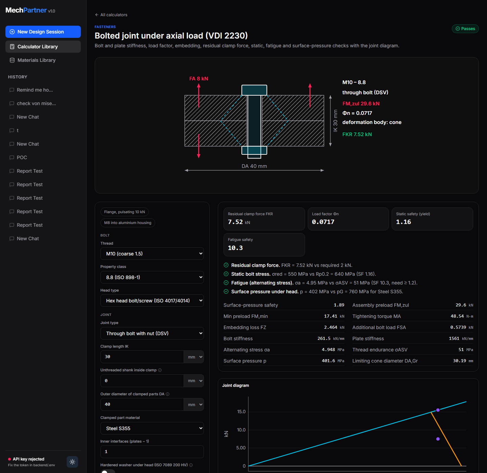
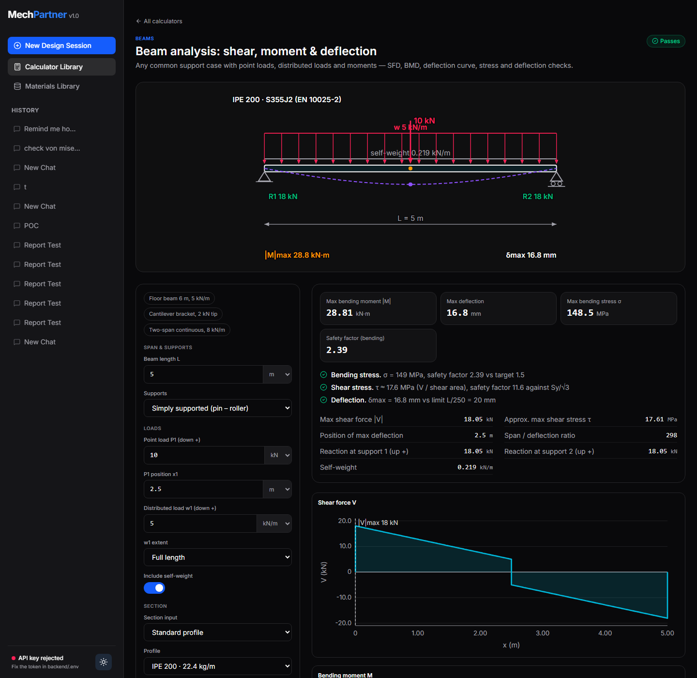
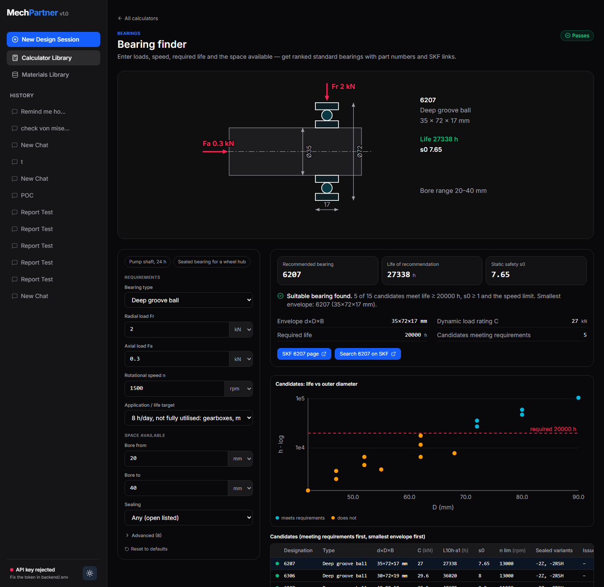
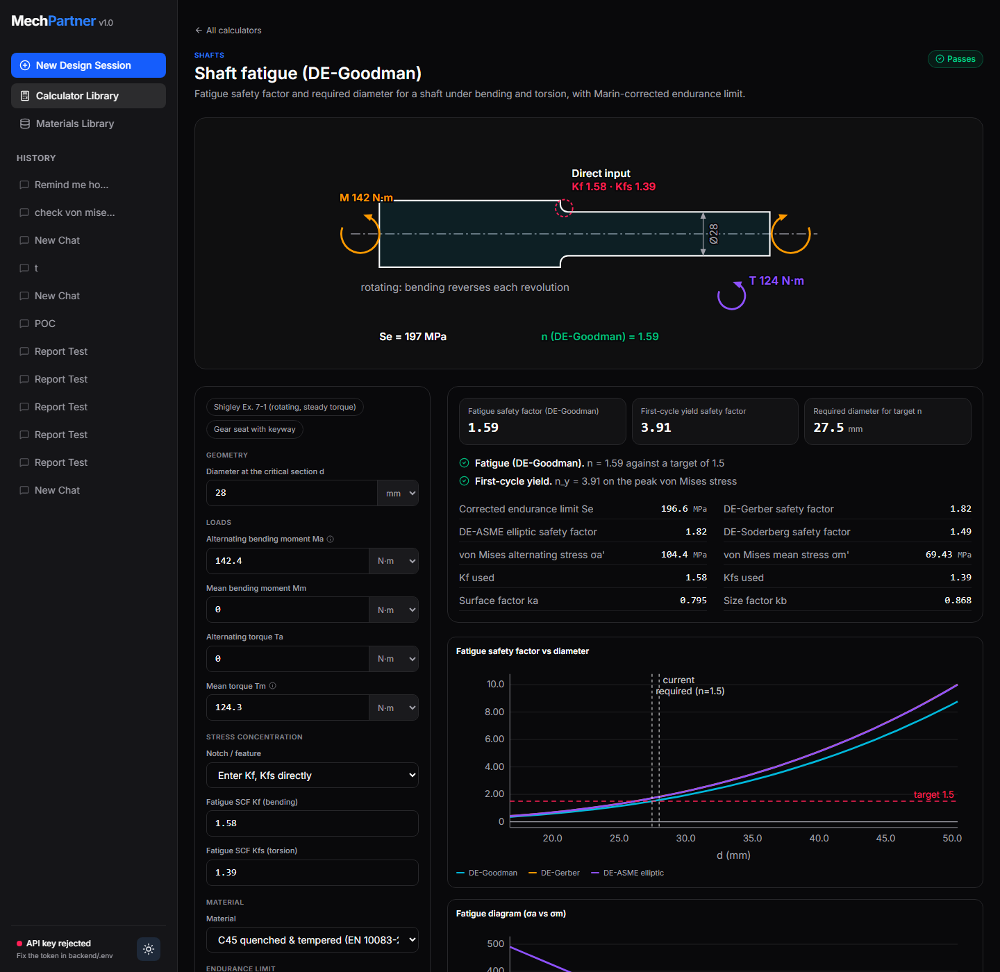
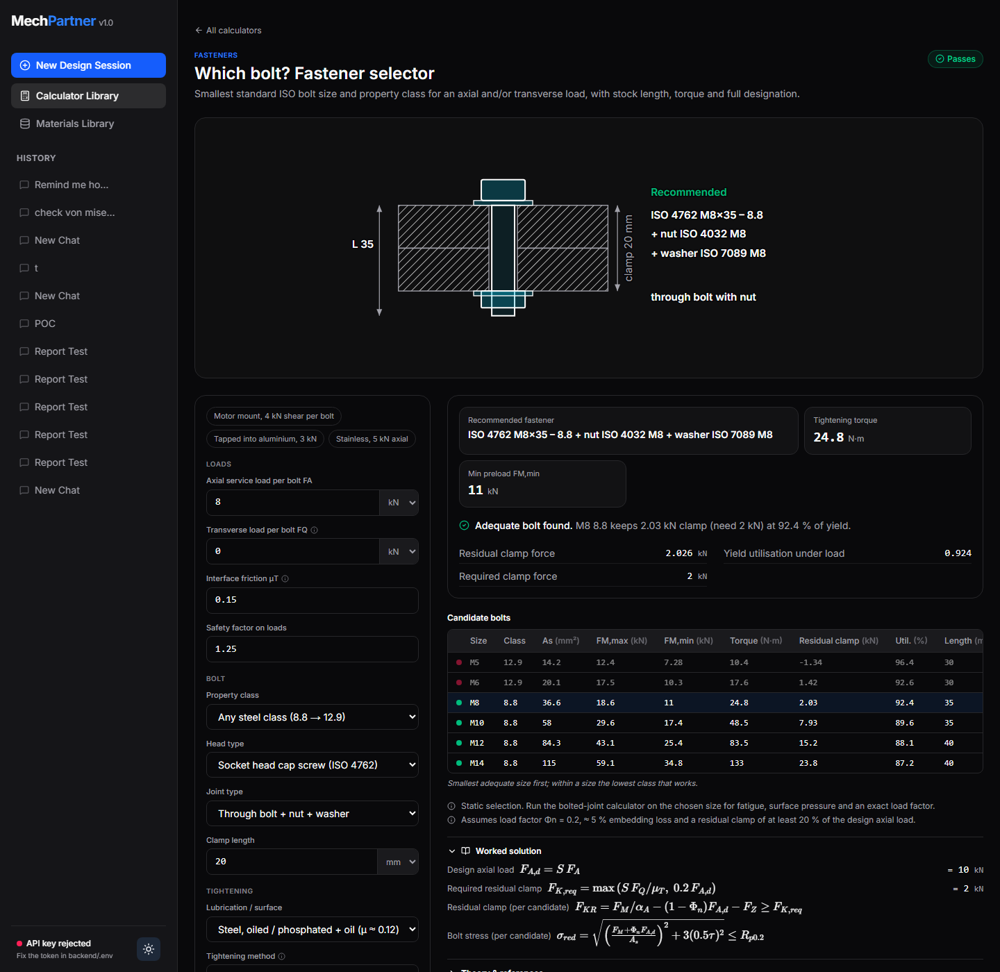

# MechPartner — an AI design partner for mechanical engineers

Describe a part, its loads and what you need to decide. MechPartner picks the right calculations,
runs them on validated engineering formulas, and answers like a senior design engineer: a
recommendation with the governing numbers, the assumptions behind it, pass/fail checks, and
**standard parts you can actually buy** — bolt size and class with tightening torque, bearing
designation with a link to the manufacturer's page, the lightest beam profile that works.

Every answer comes with **interactive calculators**: an annotated diagram, live inputs with unit
switching, results, safety checks, plots and the full worked solution with formulas and the
standard it follows. Change any input and everything recalculates.



| | |
| :---: | :---: |
|  |  |
| Beam analysis (FEM) — any supports and loads | Bearing finder — ISO 281 life, SKF part numbers and links |
|  |  |
| Shaft fatigue — DE-Goodman, Gerber, ASME, Soderberg | Which bolt? — size, class, length, torque |

## What's inside

| Area | Calculators |
| :--- | :--- |
| **Fasteners** | Bolt/nut/hole dimensions, preload & tightening torque (VDI 2230), bolted joint with joint diagram, slip-critical shear joints, thread engagement, eccentric bolt groups, bolt selector |
| **Bearings** | ISO 281 rating life incl. modified life (a<sub>ISO</sub>), bearing selector with SKF designations and links, required dynamic load rating |
| **Beams** | Beam analysis (FEM: any supports, point/distributed loads, moments) with shear, moment and deflection diagrams; section properties; standard profile selector (IPE, HEA, HEB, UPN, RHS, CHS) |
| **Shafts, keys & fits** | Shaft fatigue sizing (DE-Goodman/Gerber/ASME), critical speed, parallel keys (DIN 6885), ISO 286 limits & fits, interference fits (Lamé) |
| **Gears, springs, welds** | Spur gear bending & contact, compression and torsion springs, fillet weld groups (AWS / EN 1993-1-8) |
| **Structures & fatigue** | Column buckling (Euler/Johnson), pressure vessels (thin and Lamé), fatigue life with S–N and Haigh diagrams, stress concentration factors, combined loading on round bars |

**27 calculators**, a database of **285 standard bearings** and full ISO metric fastener tables
(M2–M48, fine pitches, property classes 4.6–12.9 and A2/A4, heads, nuts, washers, holes). The
full list with inputs and references is in [docs/CALCULATORS.md](docs/CALCULATORS.md). Every
calculator also opens directly from the **Calculator Library**, no chat needed.

## Quick start

You need **Python 3.10+** and **Node.js 20+**.

```bash
git clone https://github.com/<your-username>/mechpartner.git
cd mechpartner
```

Then run the launcher — it sets everything up on first run and opens the app:

- **Windows:** double-click `start.bat` (or run it in a terminal)
- **macOS / Linux:** `./start.sh`

On first run it asks for your **Replicate API token** (get one at
[replicate.com/account/api-tokens](https://replicate.com/account/api-tokens), it starts with `r8_`).
Press Enter to skip — the calculators and library work fully offline; the AI copilot needs the key.
The token is stored only in `backend/.env` on your machine.

The app runs at <http://localhost:3000>, the API at <http://127.0.0.1:8001> (docs at `/docs`).
The first launch builds the frontend (about a minute); later launches start in seconds. Working on
the code? Run `start.bat dev` / `./start.sh dev` for hot reload.

Changed your key later? Edit `REPLICATE_API_TOKEN` in `backend/.env` and restart. The status in
the bottom-left of the sidebar shows which model is active and whether the key was accepted.

<details>
<summary>Manual setup</summary>

```bash
# backend
python -m venv .venv
.venv/bin/pip install -r backend/requirements.txt      # Windows: .venv\Scripts\pip
cp backend/.env.example backend/.env                     # then put your token in REPLICATE_API_TOKEN
cd backend && ../.venv/bin/python -m uvicorn main:app --port 8001

# frontend (second terminal)
cd frontend && npm install && npm run dev
```
</details>

### Choosing the model

By default the copilot uses **Claude Haiku 4.5** on Replicate for fast answers and **Claude Sonnet 4.6**
for *Deep review*. Change them in `backend/.env`:

```ini
REPLICATE_MODEL=anthropic/claude-4.5-haiku
REPLICATE_MODEL_DEEP=anthropic/claude-sonnet-4.6
```

Any Replicate text model that accepts `prompt`, `system_prompt` and `max_tokens` works. An OpenAI key
(`OPENAI_API_KEY`) is supported as an alternative. A typical question costs well under one cent with Haiku.

## How it works

```
 your question ──► PLAN     the model reads the calculator catalog and picks calculators + inputs,
                            stating every assumption it makes
               ──► COMPUTE  the backend runs them on the engineering kernel (Python, Pint units)
               ──► REVIEW   the model receives the computed numbers and writes the answer:
                            recommendation, verdict, assumptions, parts, next checks
```

The language model **never does the arithmetic** and never writes code that runs in your browser.
It only chooses from a fixed library of calculators and explains their results. Every number you
see comes from a tested formula: 347 automated tests check the calculators against textbook and
standard worked examples (Shigley, VDI 2230, ISO 281, ISO 286, closed-form beam cases) and verify
that every calculator runs cleanly on its defaults and presets.

- `backend/engineering/` — the calculator library. Each calculator is a typed definition
  (inputs with units, outputs, checks, plots, worked steps, references) — see
  [`general.py`](backend/engineering/general.py) for the reference pattern.
- `backend/copilot.py` — plan → compute → review orchestration and model providers.
- `frontend/components/calc/CalculatorView.tsx` — one renderer for every calculator.
- `frontend/components/diagrams/` — annotated SVG diagrams, labelled with live values.

## Bearing data

The bearing database uses **ISO-standard designations and boundary dimensions** (identical across
manufacturers) with **typical** load ratings. For every result you get the exact SKF designation
(e.g. `6206-2RSH`) and a direct link to SKF's product page to confirm the certified ratings before
ordering. MechPartner does not copy or redistribute manufacturer catalogues.

To use your own catalogue data (e.g. an export from your supplier), import a CSV with the columns
`designation,type,d,D,B,C,C0,Pu,n_ref,n_lim` (mm, N and rpm; `type` is one of `dgbb`, `acbb`,
`crb`, `trb`, `sabb`, `srb`, `tbb`):

```bash
cd backend
../.venv/bin/python -m engineering.bearings.importer path/to/bearings.csv
```

The file is validated row by row, stored in `backend/data/user/` (git-ignored) and overrides the
built-in values for matching designations after a backend restart.

## Development

```bash
.venv/bin/python -m pytest backend/tests -q     # backend: calculators, copilot, contract
cd frontend && npx tsc --noEmit                 # frontend types
```

Adding a calculator: create a `Calculator` in the relevant `backend/engineering/<domain>/` module,
add its diagram to `frontend/components/diagrams/<domain>.tsx`, and add known-value tests. The
registry tests automatically check that every calculator runs on its defaults and presets.

## Disclaimer

MechPartner is a design aid. Results depend on the inputs and on simplified standard methods, and
the language model can misread a question. Always review the assumptions and the worked solution,
and have safety-critical designs verified by a qualified engineer before manufacture.

## License

[MIT](LICENSE)
