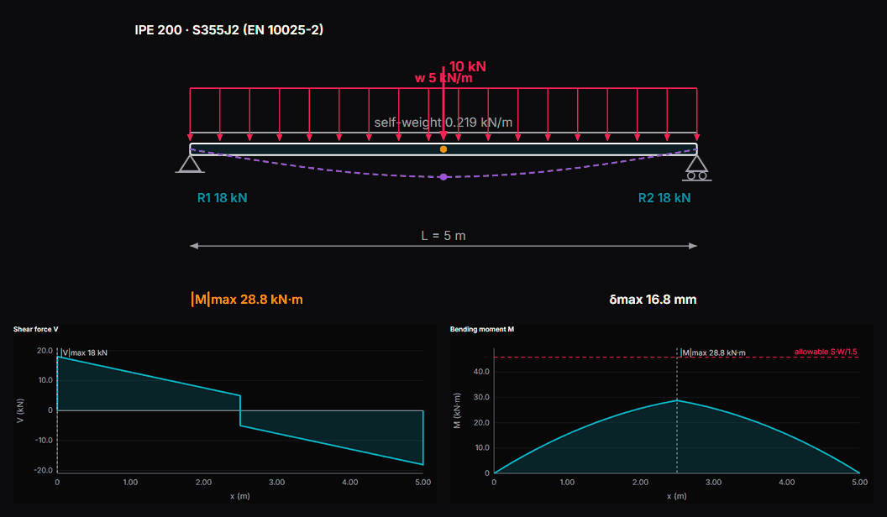
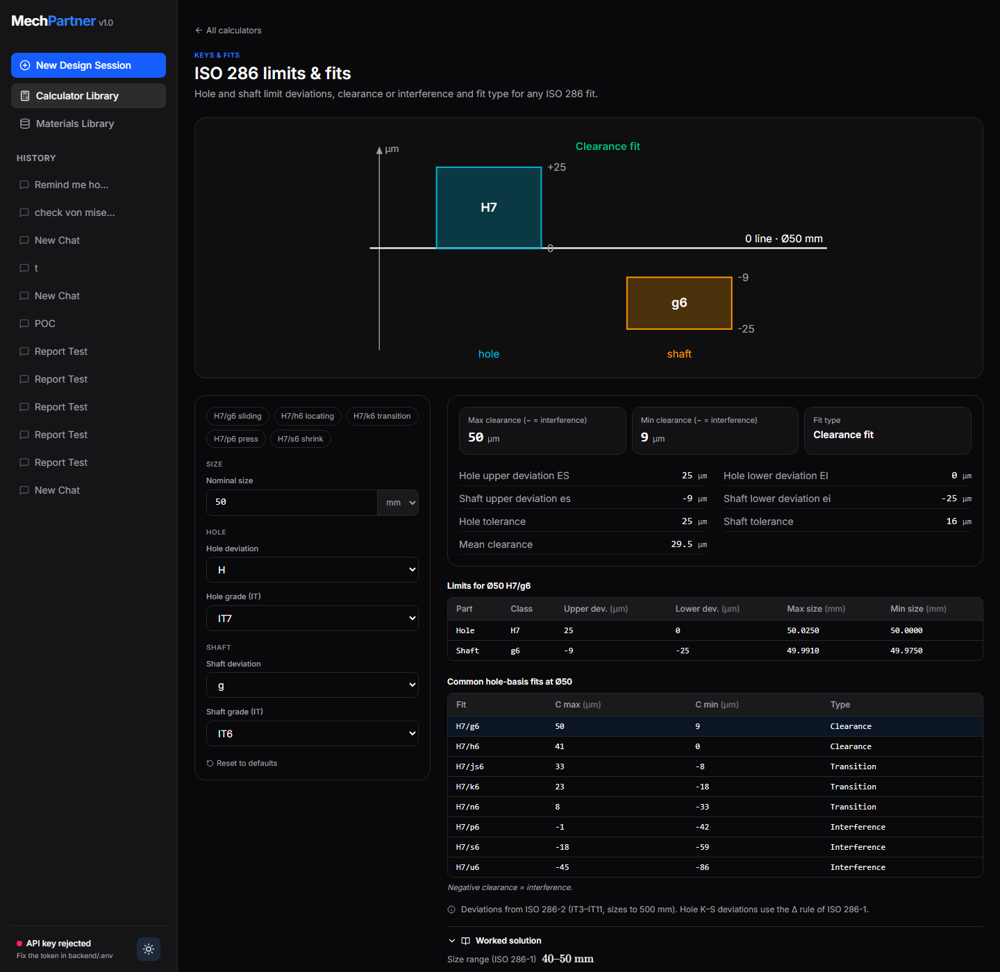
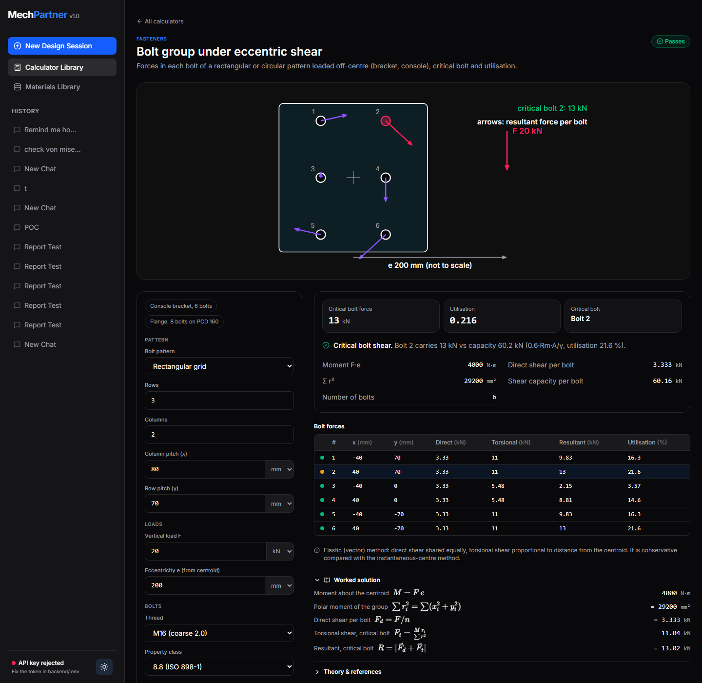
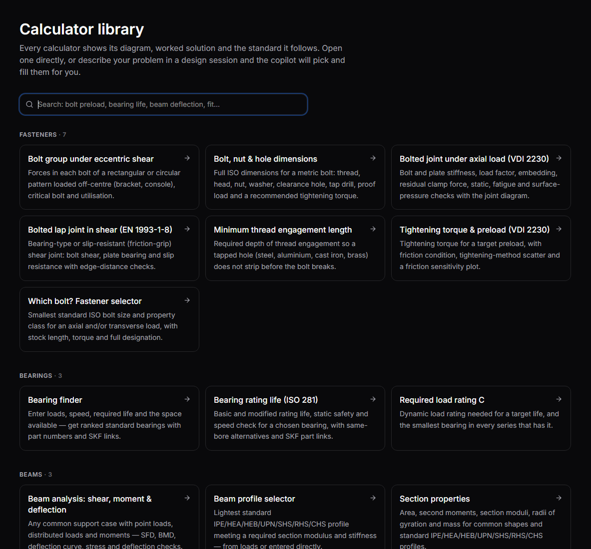
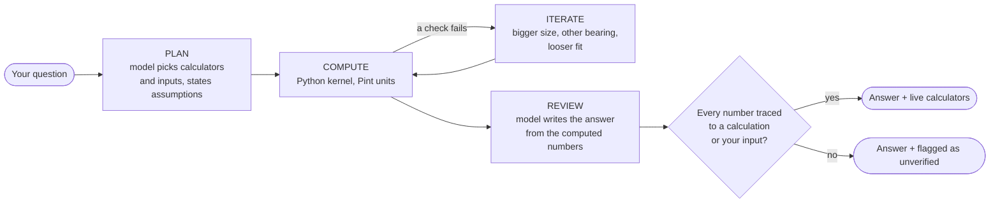

# MechCopilot

**An AI design copilot for mechanical engineers. The model picks the calculation; tested
engineering code does the math.**

[](https://github.com/DkPanseriya/MechCopilot/actions/workflows/ci.yml)


[](LICENSE)

Describe a part, its loads and what you need to decide. MechCopilot answers like a senior design
engineer: a recommendation with the governing numbers, the assumptions behind it, pass/fail
checks, and **standard parts you can actually buy**: bolt size and class with tightening torque,
a bearing designation with a link to the manufacturer's page, the lightest beam profile that works.

<p align="center">
  
  <br><sub>Move a load along the beam. Reactions, shear, moment and deflection recalculate as you type.</sub>
</p>

Every answer comes with **live calculators**: an annotated diagram, inputs with unit switching,
safety checks, plots and the full worked solution with formulas and the standard it follows.
The calculators are free, offline and need no account. The AI copilot uses your own Replicate or
OpenAI key.

## Gallery

<p align="center"><br>
<sub><b>Bolted joint (VDI 2230)</b>: preload, joint diagram, every check against its limit</sub></p>

| | |
| :---: | :---: |
|  |  |
| **Bearing finder**: ISO 281 life, SKF part numbers and links | **Shaft fatigue**: DE-Goodman, Gerber, ASME, Soderberg |
|  |  |
| **Which bolt?** Size, class, length, torque | **ISO 286 fits**: deviations and common fits |
|  |  |
| **Beam (FEM)**: any supports and loads | **Eccentric bolt group**: force per bolt, critical bolt |

## What's inside

**28 calculators**, **285 standard bearings** and full ISO metric fastener tables (M2–M48, fine
pitches, classes 4.6–12.9 and A2/A4, heads, nuts, washers, holes).

| Area | Calculators |
| :--- | :--- |
| **Fasteners** | Bolt/nut/hole dimensions, preload and torque (VDI 2230), bolted joint with joint diagram, slip-critical joints, thread engagement, eccentric bolt groups, bolt selector |
| **Bearings** | ISO 281 rating life incl. modified life (a<sub>ISO</sub>), bearing selector with SKF designations, required dynamic load rating |
| **Beams** | FEM beam analysis (any supports, point/distributed loads, moments), section properties, profile selector (IPE, HEA, HEB, UPN, RHS, CHS) |
| **Shafts, keys, fits** | Drive loads (power, chain, belt, gear forces), shaft fatigue sizing, critical speed, parallel keys (DIN 6885), ISO 286 fits, interference fits (Lamé) |
| **Gears, springs, welds** | Spur gear bending and contact, compression and torsion springs, fillet weld groups (AWS / EN 1993-1-8) |
| **Structures, fatigue** | Column buckling (Euler/Johnson), pressure vessels, S–N and Haigh fatigue life, stress concentration, combined loading |

Every calculator also opens straight from the **Calculator Library**, no chat needed. Inputs and
references for each one: [docs/CALCULATORS.md](docs/CALCULATORS.md).

<p align="center"></p>

## Why you can trust the numbers

The language model **never does the arithmetic**. It chooses from a fixed library of calculators,
states its assumptions, and explains the results. Every number comes from a tested formula.



- **415 automated tests** check the calculators against textbook and standard worked examples
  (Shigley, VDI 2230, ISO 281, ISO 286, closed-form beam cases), and run every calculator on its
  defaults and presets.
- **Grounding check.** A number in the answer that did not come from a calculation or from you is
  flagged on screen as unverified.
- **No generated code** ever runs in your browser. One renderer draws every calculator.
- **An eval suite** asks reference questions with hand-checked answers against the live model and
  reports which numbers traced back to a calculator.

## Quick start

You need **Python 3.10+** and **Node.js 20+**.

```bash
git clone https://github.com/DkPanseriya/MechCopilot.git
cd MechCopilot
./start.sh          # Windows: start.bat
```

The launcher sets everything up on first run and opens <http://localhost:3000>. It asks for a
[Replicate API token](https://replicate.com/account/api-tokens); press Enter to skip, and the
calculators and library work fully offline. The key is stored only in `backend/.env`. The first
launch builds the frontend (about a minute); later ones start in seconds. `start.bat dev` /
`./start.sh dev` gives hot reload.

A Windows installer (x64, no admin rights) is built by the *Windows installer* workflow. No release
has been published yet, so run from source until the first one.

<details>
<summary><b>Windows installer</b></summary>

1. Download **`MechCopilot-Setup-<version>.exe`** from the
   [latest release](https://github.com/DkPanseriya/MechCopilot/releases/latest).
2. Run it. It installs for your user only.
3. On first start it asks for **your own** AI key (Replicate or OpenAI), or choose
   *Calculators only*. Change it any time under **Settings**.

Key, chats and settings stay in `%LOCALAPPDATA%\MechCopilot`; the key is sent only to the provider
you chose. Uninstalling keeps that folder. The installer is not code-signed yet, so SmartScreen may
say *"Windows protected your PC"*: click **More info → Run anyway**.
</details>

<details>
<summary><b>Choosing the model</b></summary>

The copilot runs on Claude via Replicate. In **Fast** mode a small model plans the calculation and a
stronger one writes the answer; **Deep review** uses the strongest model for every step and digs
further into alternatives. Set them in `backend/.env`:

```ini
REPLICATE_MODEL=anthropic/claude-4.5-haiku          # plans the calculation (Fast)
REPLICATE_MODEL_REVIEW=anthropic/claude-sonnet-4.6  # writes the answer (Fast)
REPLICATE_MODEL_DEEP=anthropic/claude-sonnet-5      # every step in Deep review
```

Any Replicate text model that accepts `prompt`, `system_prompt` and `max_tokens` works. An OpenAI key
(`OPENAI_API_KEY`) is supported as an alternative. A Fast question costs about 3–5 US cents on
Replicate and takes 15–30 seconds; set `REPLICATE_MODEL_REVIEW` to the Haiku model for answers at
well under one cent, at some cost in judgement. The status in the bottom-left of the sidebar shows
which model is active and whether the key was accepted.
</details>

<details>
<summary><b>Manual setup</b></summary>

```bash
# backend
python -m venv .venv
.venv/bin/pip install -r backend/requirements.txt      # Windows: .venv\Scripts\pip
cp backend/.env.example backend/.env                     # then put your token in REPLICATE_API_TOKEN
cd backend && ../.venv/bin/python -m uvicorn main:app --port 8001

# frontend (second terminal)
cd frontend && npm install && npm run dev
```

The app runs at <http://localhost:3000>, the API at <http://127.0.0.1:8001> (docs at `/docs`).
</details>

<details>
<summary><b>Bearing data and your own catalogue</b></summary>

The bearing database uses **ISO-standard designations and boundary dimensions** (identical across
manufacturers) with **typical** load ratings. Every result gives the exact SKF designation
(e.g. `6206-2RSH`) and a link to SKF's product page to confirm the certified ratings before
ordering. MechCopilot does not copy or redistribute manufacturer catalogues.

To use your own data, import a CSV with the columns `designation,type,d,D,B,C,C0,Pu,n_ref,n_lim`
(mm, N and rpm; `type` is one of `dgbb`, `acbb`, `crb`, `trb`, `sabb`, `srb`, `tbb`):

```bash
cd backend
../.venv/bin/python -m engineering.bearings.importer path/to/bearings.csv
```

The file is validated row by row, stored in `backend/data/user/` (git-ignored) and overrides the
built-in values for matching designations after a backend restart.
</details>

<details>
<summary><b>Development</b></summary>

```bash
.venv/bin/python -m pytest backend/tests -q     # backend: calculators, copilot, contract
cd frontend && npx tsc --noEmit                 # frontend types
```

The tests need no API key: the copilot tests use a fake model. To measure answer quality against
the live model (needs a Replicate token, about 4 US cents per question):

```bash
cd backend && ../.venv/bin/python -m evals.run --judge
```

| Path | What it is |
| :--- | :--- |
| `backend/engineering/` | The calculator library. Each calculator is a typed definition: inputs with units, outputs, checks, plots, worked steps, references. Reference pattern: [`general.py`](backend/engineering/general.py) |
| `backend/copilot.py` | Plan, compute, iterate and review; model providers; grounding check |
| `backend/routers/` | FastAPI endpoints: chat sessions (streamed), calculators, materials, reports |
| `frontend/components/calc/CalculatorView.tsx` | One renderer for every calculator |
| `frontend/components/chat/ChatThread.tsx` | The chat, streaming answers with calculators inline |
| `frontend/components/diagrams/` | Annotated SVG diagrams, labelled with live values |

**Adding a calculator:** create a `Calculator` in `backend/engineering/<domain>/`, add its diagram
to `frontend/components/diagrams/<domain>.tsx`, and add known-value tests. The registry tests check
that every calculator runs on its defaults and presets.

**Building the Windows app:** `pip install -r desktop/requirements.txt`, then
`.\desktop\build.ps1 -Version 1.2.0`. It builds the frontend as static files, packages everything
with PyInstaller into `dist\MechCopilot\` and, with [Inno Setup 6](https://jrsoftware.org/isinfo.php)
installed, the installer `dist\MechCopilot-Setup-1.2.0.exe`. Pushing a `v*` tag publishes the
installer as a release.
</details>

## Disclaimer

MechCopilot is a design aid. Results depend on the inputs and on simplified standard methods, and
the language model can misread a question. Always review the assumptions and the worked solution,
and have safety-critical designs verified by a qualified engineer before manufacture.

## License

[MIT](LICENSE)
